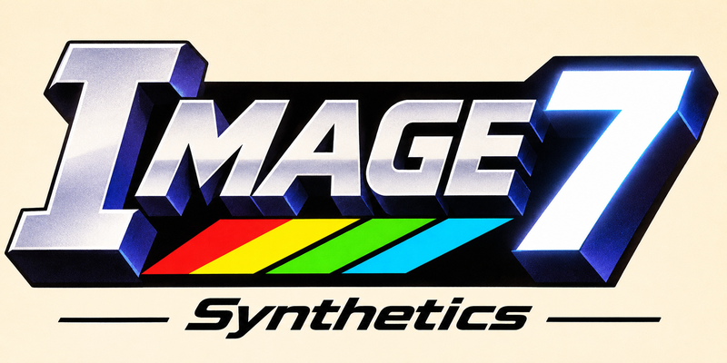
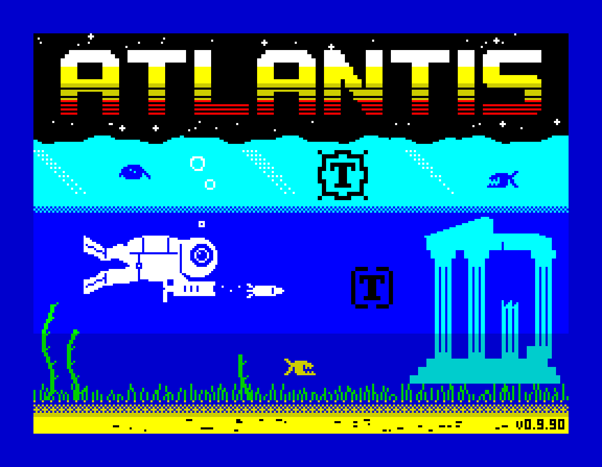
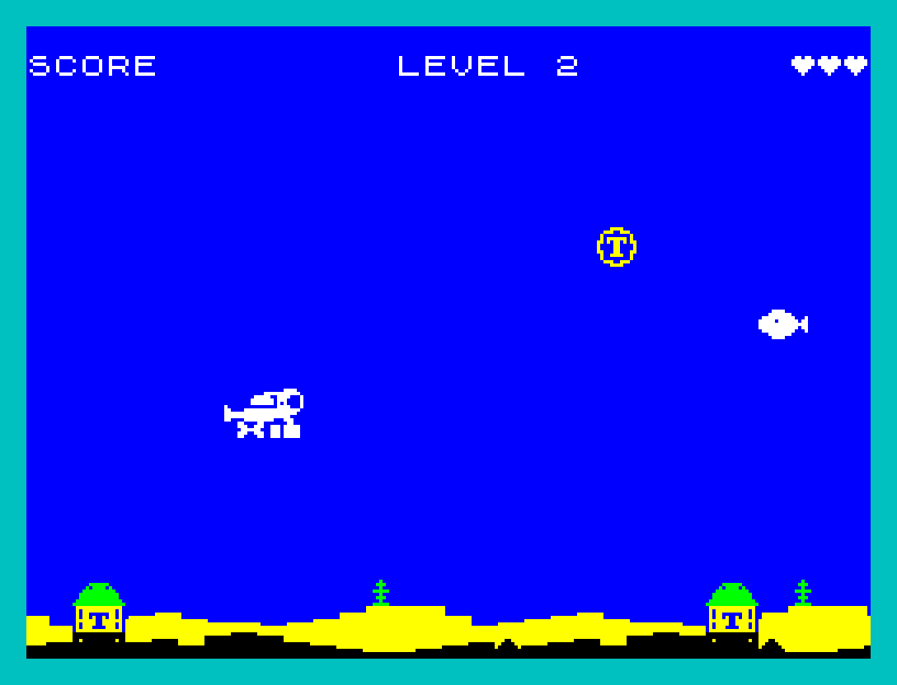
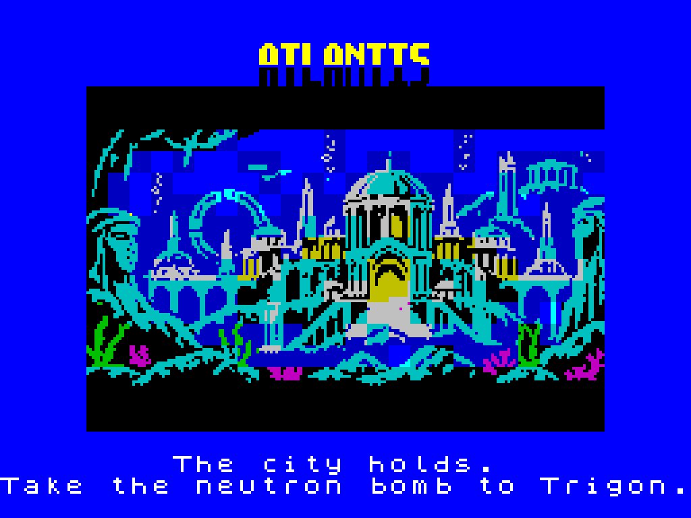
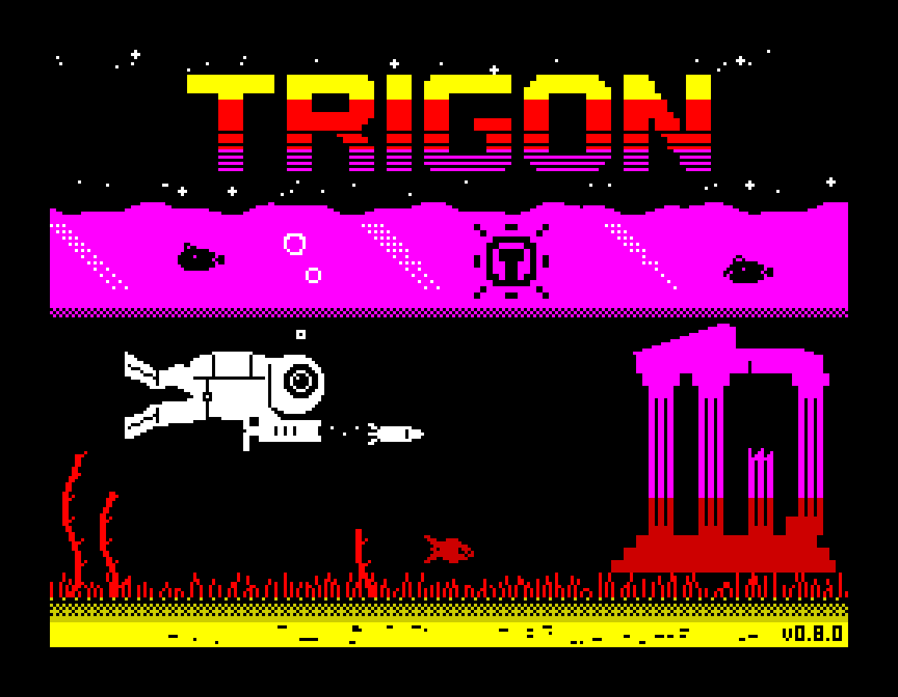
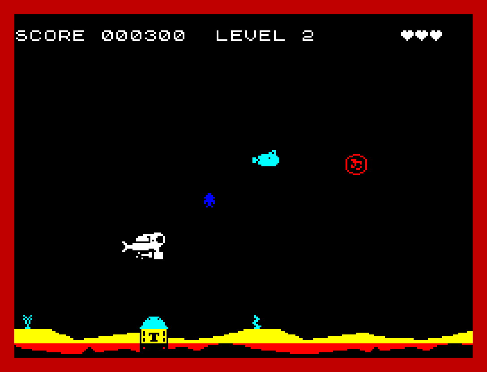

<p align="center">
  
</p>

<p align="center"><b>Inspire to create.</b></p>

# Image 7 Games

Downloads for games by **Image 7 Synthetics**.

This repository holds ready-to-play builds only. To get a game, open the
[Releases page](https://github.com/dalixinc/image7-games/releases/latest) and
download the file you need.

---

## IMAGE 7 SYNTHETICS presents... ATLANTIS

*ZX Spectrum 48K · `atlantis.tap`*

<p align="center">
  
  
</p>

**THE SEA IS CLOSING IN.**

Far beneath the waves lies Atlantis, last free city of the deep, and the
Trigon Empire has sealed it off. Their sharks prowl the currents. Their
silos rise from the seabed, primed to fire. Their bombs drift down, hungry
for a target.

Only one diver dares to swim out. YOU.

Armed with a harpoon gun and nerves of steel, you must clear the waters
level by level, gather the power-ups that will turn the tide, and keep the
city alive long enough for its scientists to finish the one weapon that
could end the blockade forever...

- Silky-smooth, **flicker-free** action at a full 50 frames a second, on an
  original 48K Spectrum!
- Wave upon wave of deadly sea creatures!
- Missiles, bombs and power-ups to master!
- The breathtaking city of Atlantis, revealed in glorious colour!

*Started in 1984. Finished at last. Forty years in the making!*

<p align="center">
  
</p>

---

## IMAGE 7 SYNTHETICS presents... TRIGON

*ZX Spectrum 48K · `trigon.tap`*

<p align="center">
  
  
</p>

**INTO THE DARK WATERS OF THE ENEMY.**

The city holds. Now the neutron bomb must reach Trigon.

Leave the blue seas of home behind and plunge into the black, blood-red
deep of the Empire itself. Twenty levels of the most hostile water ever
put on tape stand between you and your target. The Empire knows you are
coming, and it will throw everything it has at you.

- **Twenty** gruelling levels!
- New enemies, new dangers, a whole new sea!
- The Lance: a weapon so powerful it can pierce anything in its path!

*Continue your mission with the code earned by completing Atlantis.*

---

## IMAGE 7 SYNTHETICS presents... FINALE

*ZX Spectrum 48K · `finale.tap`*

**ONE DIVER. ONE BOMB. ONE LAST CHANCE.**

You carry the bomb. Trigon is close. Its elite divers swim out to meet
you, and they don't go down easily. Fight your way to the heart of the
Empire, drop the bomb into its great power generator, and break the
blockade on Atlantis forever.

*The end of the trilogy. Only the bravest will see it.*

---

## HOW TO PLAY THE SPECTRUM GAMES

Load the `.tap` file in any ZX Spectrum emulator, such as
[Fuse](https://fuse-emulator.sourceforge.net/), ZEsarUX or SpecEmu, choosing
a **48K Spectrum**. The files also work on real hardware with a tape or SD
loader. Play the games in order: each one gives you the code for the next.

| Key | Action |
|---|---|
| Q A O P, or 5 6 7 8 | Swim up, down, left and right |
| Symbol Shift + F | Change speed |
| Symbol Shift + P | Back to the menu |

---

## ATLANTIS FOR MODERN COMPUTERS (Java)

*Windows, macOS and Linux · `atlantis.jar`*

The whole trilogy, faithfully recreated to run on today's computers.

Install [Java 21](https://adoptium.net/) or newer, download `atlantis.jar`,
then run:

```
java -jar atlantis.jar
```

Add `--trigon` or `--finale` to start those games.

---

## FEEDBACK

Comments and bug reports are welcome on the
[Issues page](https://github.com/dalixinc/image7-games/issues).

<p align="center">
  <br>
  © Image 7 Synthetics. All rights reserved. Logos by Erin Art™.
</p>
